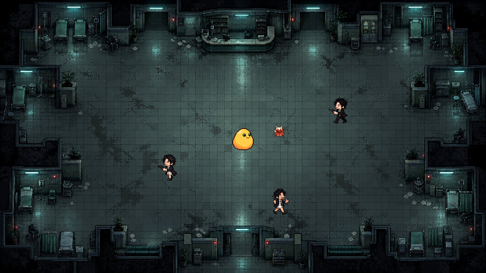

# 奶蛋求生 · Milk Egg Survival Adventure

基于 C++ 与 EasyX 的 Windows 俯视角幸存者游戏。玩家在暗色医院地图中移动，使用环绕子弹和冰冻技能对抗普通敌人、精英与 BOSS。

## 当前内容

- 四颗环绕玩家旋转的子弹。
- 普通、精英、BOSS 三种敌人；精英与 BOSS 显示血条，BOSS 会追踪、冲刺和休息。
- 玩家血量、积分成长、概率血包掉落与拾取。
- 子弹命中后的脚底灼烧与敌人之间的火焰传播。
- F 键冰冻技能、范围伤害、无敌闪烁与右下角冷却图标。
- 开始/退出菜单、音效、死亡后的视频播放，以及返回菜单重新开始。
- 原创奶蛋应用图标、Windows 资源脚本与可选安装包模板。

## 美术场景预览

## 构建与运行

1. 在 Windows 上使用 Visual Studio，安装「使用 C++ 的桌面开发」工作负载与 Windows SDK。
2. 当前项目使用 MSVC v145、C++20、Unicode 与 /utf-8；建议使用支持 .slnx 的 Visual Studio 2026。较早版本可直接打开 MESA/MESA.vcxproj，按本机工具链调整平台工具集。
3. 在开发电脑安装并配置 EasyX，确保使用匹配的 x64 头文件、库与 Release /MT 运行库。
4. 打开 MESA/MESA.slnx，选择 **Release / x64**，生成解决方案。
5. 输出到 MESA/dist/奶蛋求生/。按下面的目录结构复制资源，再双击奶蛋求生.exe。

~~~text
MESA/dist/奶蛋求生/
├── 奶蛋求生.exe
├── img/                           ← 复制 MESA/img 整个目录
├── mus/                           ← 复制 MESA/mus 整个目录
├── art_resources/
│   ├── enemy_variant_2/           ← 复制同名精英素材目录
│   └── enemy_variant_3/           ← 复制同名 BOSS 素材目录
└── video/
    └── game_over.avi              ← 复制 MESA/video/game_over.avi
~~~

程序启动时以 EXE 所在目录查找资源，所以在 Visual Studio 按 F5 同样需要上述资源位于输出目录内。完整打包步骤见 [Windows 应用打包教程](MESA/Windows应用打包教程.md)。

当前项目已经采用 wWinMain 窗口入口，发布配置是 Release / x64；其他配置需要相应配置窗口子系统后再使用。

## 操作

| 操作 | 按键 |
|---|---|
| 移动 | 方向键 |
| 释放冰冻技能 | F |
| 死亡后播放视频 | 1 或小键盘 1 |
| 死亡后直接回菜单 | 点击「确认」 |
| 播放途中返回菜单 | 点击窗口右上角 × |
| 退出进程 | 主菜单「退出游戏」 |

## 目录

| 目录/文件 | 内容 |
|---|---|
| MESA/main.cpp | 当前游戏源代码 |
| MESA/MESA.slnx、MESA.vcxproj | Visual Studio 解决方案和项目 |
| MESA/img | 运行所用地图、菜单、角色、血条、子弹与技能素材 |
| MESA/mus | 运行音频 |
| MESA/video | 结束视频与用户提供的原录屏 |
| MESA/art_resources | 敌人变体、美术源图、预览与生成记录 |
| MESA/myimg | 用户提供的参考素材 |
| MESA/packaging | 应用图标、资源脚本与安装包模板 |

运行资源、参考图、原始美术图与开发文档均纳入仓库。Visual Studio 缓存、编译中间文件、个人项目设置、dist 发布目录与备份文件由 .gitignore 排除，保留在本地。

## 开发与素材文档

- [素材与工具说明](MESA/说明.md)
- [游戏更新修改指南](MESA/游戏更新修改指南.md)
- [冰冻技能与 BOSS 更新指南](MESA/冰冻技能与BOSS更新指南.md)
- [血包、灼烧与敌人更新指南](MESA/血包灼烧与敌人更新指南.md)
- [死亡视频与返回菜单指南](MESA/死亡视频与返回菜单修改指南.md)
- [视频闪烁与关闭返回菜单修复](MESA/视频闪烁与关闭返回菜单修复指南.md)
- [Windows 应用打包教程](MESA/Windows应用打包教程.md)
- [应用图标生成记录](MESA/packaging/图标生成说明.md)

开发指南记录了迭代过程，其中较早数值可能已被后续调整。当前玩法与数值以 main.cpp 为准。
