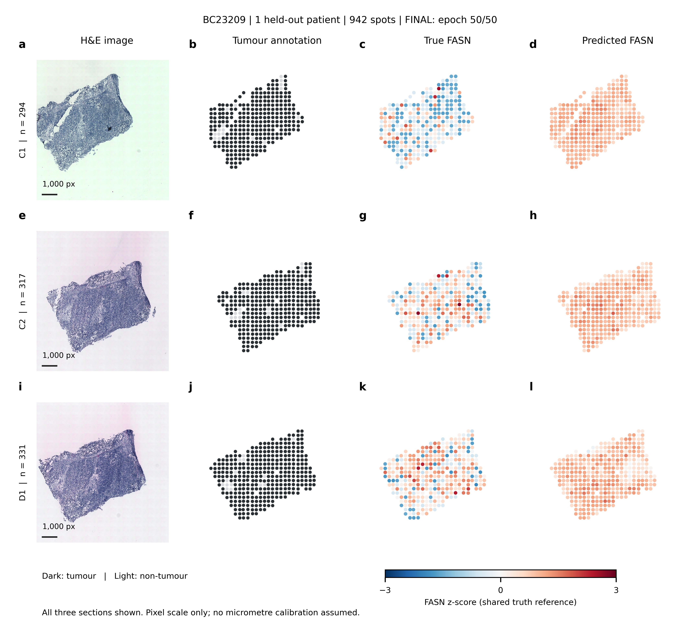
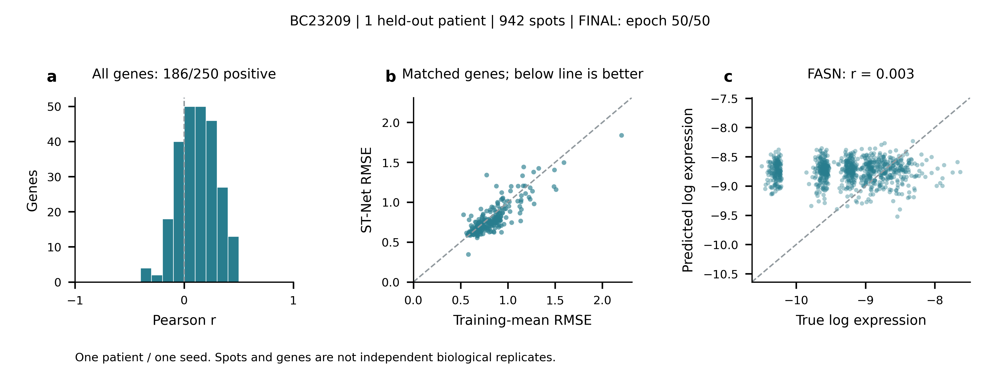
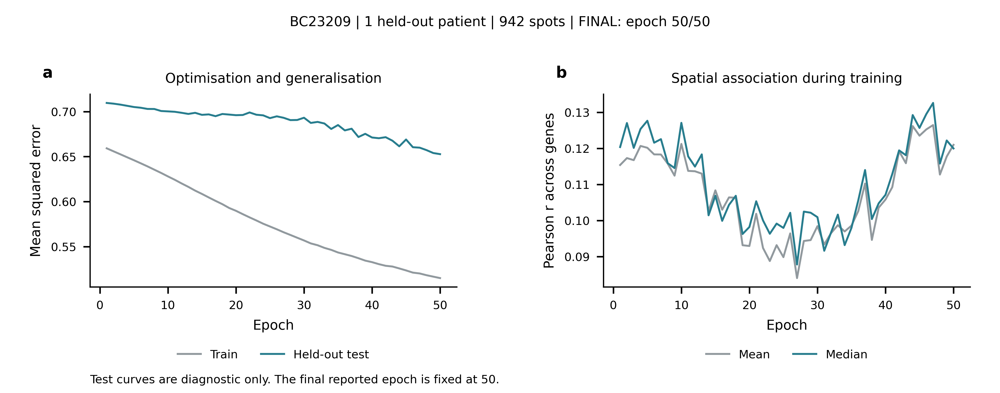

# ST-Net 结果可视化

使用 nature-figure skill 和 Python / Matplotlib，参考本地论文 Fig.2 的证据组织方式，用本次实际预测重新绘制。第 50 轮正式图已完成，当前仅保留 **PNG** 格式；预览、PDF/SVG 和检查中间图已删除。

## 正式图

入口：[结果图导航](output/figures/README.md)。

| PNG 文件 | 内容 |
| --- | --- |
| `fig1_spatial_FASN.png` | 全部三张切片：H&E、肿瘤标记、真实和预测 FASN |
| `fig2_heldout_performance.png` | 全部 250 基因相关性、逐基因配对 RMSE、FASN 全部测试点散点 |
| `fig3_learning_curves.png` | 完整 50 轮 MSE、逐基因相关性均值和中位数轨迹 |

文件均在 `output/figures/final_epoch_050/`，宽 183 mm，600 dpi，英文图内标注。布局与文字已逐图查看，最终绘图区对齐、5 pt 字号和 PDF 几何碰撞检查通过；检查是在删除矢量中间文件之前完成的。精简验证记录在 `reproduction/reports/final-figure-validation.json`。这不等同于独立科学审核或特定期刊投稿认证。

## 数据与图注

空间图预先固定展示论文使用的 FASN，保留测试患者全部三张切片，没有按测试效果选基因或切片。真实与预测共用真实表达的均值、标准差和色标，避免独立拉伸预测颜色夸大空间变化。图中保留原始表达偏差；超出色标的点仅截断显示颜色，具体数量在绘图清单中记录。

H&E 图仅等比例缩小显示，没有局部亮度、对比度或 gamma 调整；尺度条为原图像素，没有假定精确微米标定。肿瘤标记使用原始注释。

统计图使用全部 250 个基因和 FASN 的全部 942 个测试点。模型与基线按同一基因配对，虚线是恒等线而非拟合线。均值基线仅来自训练患者。

训练图包含全部 50 轮，不按测试曲线挑选轮次。只有 1 位测试患者和 1 个 seed，三张切片不是三位患者，点和基因也不是独立生物学重复，因此不虚构生物学置信区间、P 值、跨 23 患者一致性或外部验证 AUROC。

## 保留的绘图源数据

目录 `output/simplified/figure_source/`：

- `learning_history.csv`：全部 50 轮 MSE 与相关性，删除各轮预测后仍可重画曲线。
- `spatial_FASN.csv`：空间位置、标记、FASN 真值和预测。
- `all_genes.csv`：逐基因相关性与模型/基线 RMSE。
- `figure_manifest.json`：第 50 轮预测校验值、变换参数、切片样本数及图像来源。

完整最终预测为 `output/simplified/pred_50.npz`。

## 重画 PNG

在项目根目录激活 STNet 后运行：

```bash
python reproduction/figures/plot_results.py \
  --prediction output/simplified/pred_50.npz \
  --final --png-only
```

绘图脚本会读取保留的 50 轮历史 CSV。`--png-only` 会在生成与审计后删除 PDF/SVG，包括检查覆盖图；保留 PNG 和必要数据、文字记录。当前正式图目录仅有三张 PNG，其他必要材料已归入实验数据和报告目录。


---

## 已完成实验的详细说明：固定留出 BC23209 的 50 轮简化复现

以下说明对应本项目实际完成并保留的第 50 轮实验。三张配图均为最终 PNG，不是训练中途的预览。未完成、已停止的其他实验不纳入本节结论。

### 一、实验概况与目的

**实验名称：基于 H&E 病理图像的空间基因表达预测——单患者留出简化实验。**

对应论文 *Integrating spatial gene expression and breast tumour morphology via deep learning*（Nature Biomedical Engineering，2020）的主任务：根据组织局部形态，预测该位置的多基因表达。图形组织方式参考论文 Fig.2，但图中数据全部来自本次本地实验，未复制论文的实验结果。

本次实验主要回答三个问题：

1. **流程是否能够运行？** 能否完成原始数据整理、图像读取、模型训练、留出患者测试与指标计算？
2. **模型是否优于简单基线？** 输入图像后，是否比“每个位置都预测训练集平均表达”具有更低的误差？
3. **模型是否预测出了空间异质性？** 除了平均表达量接近之外，能否辨别同一患者不同位置的表达高低？

第三个问题是本任务的核心：仅仅把各位置预测成相近的数值，可能降低部分平方误差，但不能说明模型恢复了组织内部的空间表达变化。

本次采用 **22 位患者训练、1 位患者测试、固定 50 轮** 的简化设置，没有进行论文的内部四折选轮次，也没有完成 23 位患者逐一留出的全套交叉验证。因此，本节是一个患者上的独立测试结果说明，不能当作完整论文指标的复现报告。

### 二、数据集与实验划分

#### 2.1 数据来源和规模

数据来自作者代码仓库所链接的 [Mendeley 数据集第 5 版](https://data.mendeley.com/datasets/29ntw7sh4r/5)，内容为乳腺癌 H&E 病理图像及对应的空间转录组数据，许可为 CC BY 4.0。

| 项目 | 本地实际数据 |
| --- | --- |
| 患者数 | 23 |
| 组织切片数 | 68 |
| 预处理后的可用空间点数 | 30,627 |
| 原始计数对应的基因并集 | 26,933 |
| 模型预测的目标基因数 | 平均表达量最高的 250 个基因 |
| 图像输入 | 以每个空间点为中心的 224 × 224 像素 RGB 图块 |
| 监督标签 | 该空间点的归一化、自然对数变换后的基因表达 |
| 辅助注释 | 空间位置、患者与切片编号、肿瘤/非肿瘤标记 |

原始文件有 273 个，下载后按清单核验 SHA-256。实际切片统计见 [dataset-summary.json](reproduction/reports/dataset-summary.json)。

需要区分“本地版本统计”和“论文报告统计”：论文写的是 30,612 个点、26,949 个基因，而本次为 30,627 个点、26,933 个基因。两者存在差异，尚不能声称数据版本与论文完全相同；实验中没有为凑齐论文数量而任意删除点或补充基因。

#### 2.2 训练集和测试集

| 数据部分 | 患者 | 切片数 | 空间点数 |
| --- | --- | --- | --- |
| 训练集 | 除 BC23209 外的 22 位患者 | 65 | 29,685 |
| 测试集 | BC23209 | 3 | 942 |

BC23209 在元数据中的亚型为 TNBC，即三阴性乳腺癌。测试集的三张切片为：

| 切片 | 测试点数 | 空间图对应行 |
| --- | --- | --- |
| C1 | 294 | 第一行 |
| C2 | 317 | 第二行 |
| D1 | 331 | 第三行 |
| 合计 | 942 | 全部三行 |

同一患者的切片没有同时进入本次训练集和测试集。这里的 942 个点是同一患者内的空间观测，三张切片也是同一患者的技术/组织切片，**不能当作 942 位独立患者或 3 位独立患者**。

目标基因筛选沿用作者代码，以全量数据的表达均值选出 250 个基因。因此，患者划分虽是 22/1，但不能把整套流程描述为“所有特征选择都只使用训练集”。

#### 2.3 表达标签的含义

设一个点的原始基因计数为 \(c_{s,g}\)，全部基因数为 \(N_{\mathrm{all}}=26933\)。本次使用的标签为：

$$
y_{s,g}=\ln\left(\frac{c_{s,g}+1}{N_{\mathrm{all}}+\sum_{h=1}^{N_{\mathrm{all}}}c_{s,h}}\right).
$$

其中，\(s\) 表示空间点，\(g\) 表示基因。分母使用全部基因的计数及伪计数，而不是仅对 250 个目标基因求和。

加 1 是为了避免零计数取对数。分数通常小于 1，因此取自然对数后常为负数。例如，−8 的表达高于 −10，**负数不代表“负的 RNA 数量”**。本节涉及的误差和散点坐标均基于这一变换后的表达，不能直接理解成原始 UMI 计数误差。

### 三、模型与训练设置

| 设置 | 本次取值 |
| --- | --- |
| 主干网络 | ImageNet 预训练 DenseNet-121 |
| 输出层 | 250 维线性输出，对应 250 个目标基因 |
| 训练任务 | 多输出回归，优化平方误差 |
| 优化器 | SGD |
| 学习率 | 1 × 10⁻⁶ |
| 动量 | 0.9 |
| Weight decay | 0 |
| Batch size | 32 |
| 随机种子 | 0 |
| 训练轮数 | 固定 50 轮 |
| 训练增强 | 按作者实现进行翻转和直角旋转等增强 |
| 测试处理 | 对八种对称变换的预测取平均 |
| 硬件与软件 | WSL；RTX 5080 Laptop GPU；Python 3.10；PyTorch 2.7.1 + CUDA 12.8 |

训练和测试在每轮结束时记录。最终报告预先固定的**第 50 轮**，没有查看测试曲线后改用测试分数最好的轮次。实验于 2026-10-22 20:03 左右完成训练与评估，总耗时约 80 分钟。

### 四、评价指标与最终数值

#### 4.1 指标如何计算

- **MSE，均方误差**：对测试集中所有点、所有目标基因的平方误差取平均，越低越好。
- **RMSE，均方根误差**：先计算上述整体 MSE，再开平方，单位与变换后的表达一致。本次整体 RMSE 不是“先计算每个基因 RMSE 再取平均”。
- **逐基因 Pearson 相关系数**：固定一个基因，对比它在 942 个位置上的预测值和真实值。接近 1 表示较好的线性同向变化，接近 0 表示线性对应弱，负值表示反向变化。
- **Pearson 中位数/均值**：对 250 个逐基因相关系数再取中位数或均值，不是先混合所有基因数值再算一个相关系数。
- **训练均值基线**：每个基因只计算训练集中该基因标签的平均值，对测试集中每个位置都预测这一常数。它不读取测试表达来确定预测值，也不利用图像区分位置。

对 \(n=942\) 个点、\(G=250\) 个基因，整体误差的公式为：

$$
\mathrm{MSE}=\frac{1}{nG}\sum_{s=1}^{n}\sum_{g=1}^{G}(\hat y_{s,g}-y_{s,g})^2,
\qquad \mathrm{RMSE}=\sqrt{\mathrm{MSE}}.
$$

#### 4.2 第 50 轮的最终结果

| 指标 | 数值 | 解读 |
| --- | --- | --- |
| 测试 MSE | 0.65269 | 当前模型的整体平方误差 |
| 测试 RMSE | 0.80789 | 当前模型的整体误差 |
| 训练均值基线 RMSE | 0.84260 | 不区分空间位置的简单参照 |
| 相对基线的 RMSE 降幅 | 约 4.12% | 模型有改善，但幅度有限 |
| 相对基线的 MSE 降幅 | 约 8.07% | 该比例与 RMSE 降幅不同，不应混写 |
| 逐基因 Pearson 均值 | 0.12099 | 整体空间关联较弱 |
| 逐基因 Pearson 中位数 | 0.11999 | 典型基因的空间关联较弱 |
| 正相关基因数 | 186 / 250，约 74.4% | 只说明相关系数大于零，不代表显著或预测准确 |
| Pearson > 0.3 的基因数 | 40 / 250 | 描述部分基因信号，不作为统一“成功”判定阈值 |
| RMSE 优于均值基线的基因数 | 166 / 250 | 多数基因有所改善 |
| RMSE 差于均值基线的基因数 | 84 / 250 | 改善不是所有基因一致发生 |

数值来源：[最终指标汇总](output/simplified/pred_50.summary.json)、[逐基因指标](output/simplified/pred_50.metrics.csv)、[逐基因模型与基线数据](output/simplified/figure_source/all_genes.csv)。

### 五、图 1：空间表达对照图



**图 1 | 留出患者 BC23209 的组织形态与 FASN 空间表达对照**。三行依次为 C1、C2、D1 切片，分别含 294、317、331 个测试点。a/e/i 为完整 H&E 图像；b/f/j 为肿瘤注释，深色点表示肿瘤，浅色点表示非肿瘤；c/g/k 为真实 FASN 表达；d/h/l 为第 50 轮 ST-Net 预测。真实和预测表达使用同一真实表达参考均值、标准差和 −3 至 3 的色标。所有切片、测试点均展示，FASN 在绘图前固定，不按本次预测效果选择。图像仅等比例缩小显示，尺度条为原图 1,000 像素。本图描述同一位患者的三个切片，不给出独立患者重复的置信区间。源数据见 [spatial_FASN.csv](output/simplified/figure_source/spatial_FASN.csv)。

#### 5.1 每一行、每一列表示什么

| 位置 | 图内标题或标记 | 含义 |
| --- | --- | --- |
| 第一、二、三行 | C1、C2、D1 | 同一患者的三个组织切片 |
| 左侧 n | 294、317、331 | 各切片纳入测试的空间点数，不是患者数 |
| 第一列 | H&E image | 模型取图块的组织图像背景 |
| 第二列 | Tumour annotation | 提供空间与组织类别参照，不是模型预测的基因数值 |
| 第三列 | True FASN | 实验测得并经过标签变换的 FASN 表达 |
| 第四列 | Predicted FASN | 模型根据图像生成的 FASN 预测 |

#### 5.2 横纵坐标、尺度和颜色

本图是**空间位置图**，不是普通的表达数值散点图。

- 横向对应原始组织图像的像素 x 位置，向右增大；纵向对应图像像素 y 位置，向下增大。图中为突出组织形态，隐藏了数值刻度。
- 左侧 C1/C2/D1 和 n 是行标签，不是纵轴表达数值。
- 每个圆点是一个测量位置，点的位置来自真实像素坐标；点的颜色才编码表达量。
- H&E 图上的 `1,000 px` 表示原图像素尺度，不能当作 1 mm。当前没有使用未经确认的微米标定。
- 真实与预测两列共用色标：蓝色为低于真实表达参考均值，红色为高于该均值，近白色为接近均值。

色标使用的 z-score 为：

$$
z_{s}^{\mathrm{true}}=\frac{y_{s,\mathrm{FASN}}-\mu_{\mathrm{true}}}{\sigma_{\mathrm{true}}},
\qquad
z_{s}^{\mathrm{pred}}=\frac{\hat y_{s,\mathrm{FASN}}-\mu_{\mathrm{true}}}{\sigma_{\mathrm{true}}}.
$$

本次参考均值约为 −9.31480，标准差约为 0.60670，来自全部 942 个测试点的真实 FASN 标签。这个测试集参考值**只用于绘图显示**，没有用于调整训练或正式指标。色标零点是这一平均值，不是“不表达 FASN”。实际本图没有点超出 −3 至 3 的范围。

#### 5.3 这张图说明什么

真实 FASN 在组织内有明显的高低变化，预测图则更接近较为统一的暖色，变化幅度较小。全体测试点的真实标签标准差约为 **0.607**，预测标准差约为 **0.180**；预测均值约为 **−8.744**，高于真实均值约 **−9.315**，因此预测列整体偏暖。

这说明 FASN 在该患者上既有数值偏差，也未充分恢复位置间的高低变化。不能因为预测点覆盖了组织轮廓，就认为基因表达预测正确：点的位置本来就是输入数据提供的，真正需要比较的是同一位置的表达颜色及定量指标。

同时，三张切片的表现存在差异：FASN 在 C1、C2、D1 的 Pearson 分别约为 **−0.044、0.205、−0.030**，合并后为 **0.003**。因此，结论应限定为“该患者合并结果很弱、部分切片存在一定关联”，而不是声称所有切片都完全没有信号。

### 六、图 2：测试表现与数值校准



**图 2 | 留出患者上的基因表达预测表现与基线对照**。a 展示全部 250 个基因在 942 个测试点上的 Pearson 相关系数分布，灰色虚线标记零相关，186 个基因的相关系数为正。b 将每个基因的 ST-Net RMSE 与训练均值基线 RMSE 配对，虚线为 y=x，线下表示模型误差更小。c 展示预先固定的 FASN 在全部 942 个测试位置的真实值与预测值，坐标均为归一化后的自然对数表达，虚线为数值相等的参考线。相关性和误差均为一个测试患者、一个随机种子的描述性结果，不提供患者间置信区间或显著性推断。源数据见 [all_genes.csv](output/simplified/figure_source/all_genes.csv) 和 [spatial_FASN.csv](output/simplified/figure_source/spatial_FASN.csv)。

#### 6.1 图 2a：所有基因的 Pearson 分布

| 元素 | 图内文字 | 含义 |
| --- | --- | --- |
| 横坐标 | Pearson r | 每个基因在 942 个空间点上的预测—真实相关性，范围 −1 至 1 |
| 纵坐标 | Genes | 落入该相关性区间的基因数量，不是细胞数或患者数 |
| 柱形 | 青色 | 250 个基因的相关性频数分布；区间宽度为 0.1 |
| 竖直虚线 | r=0 | 正相关与负相关的分界，不是显著性阈值 |
| 顶部文字 | 186/250 positive | 相关系数大于零的基因数量 |

柱子主要集中在零附近至较低的正相关区间，表明整体相关性不高，但有一部分基因达到较明显的正相关。不能将“74.4% 为正相关”改写成“74.4% 的基因被准确预测”或“74.4% 的基因显著可预测”。

#### 6.2 图 2b：ST-Net 是否优于训练均值基线

| 元素 | 图内文字 | 含义 |
| --- | --- | --- |
| 横坐标 | Training-mean RMSE | 该基因由训练均值基线预测的 RMSE |
| 纵坐标 | ST-Net RMSE | 同一基因由 ST-Net 预测的 RMSE |
| 每个点 | 青色圆点 | 一个基因，两个坐标是同一基因的配对误差，共 250 点 |
| 虚线 | y=x | 两种方法误差相同的参考线，不是回归拟合线 |

- 点在虚线下方：纵坐标小于横坐标，ST-Net 的误差更低。
- 点在虚线上方：ST-Net 的误差更高。
- 点靠近虚线：两种方法表现接近。

本次有 **166 个基因在线下、84 个在线上**。模型对不少基因有改善，但没有形成所有基因一致、远离基线的大幅优势。整体 RMSE 改善约 4.12%，说明优势存在但有限。

还应注意：不同基因的表达变异和误差尺度不同，不能只凭某个点的 RMSE 高低判断该基因的相关性好坏。这里最有意义的是**同一基因的模型—基线配对比较**。

#### 6.3 图 2c：FASN 的真实表达和预测是否一致

| 元素 | 图内文字 | 含义 |
| --- | --- | --- |
| 横坐标 | True log expression | 一个测试点的真实 FASN 归一化自然对数表达 |
| 纵坐标 | Predicted log expression | 同一测试点的模型预测表达 |
| 每个点 | 青色圆点 | 一个测试位置，共 942 个；透明度用于展示重叠，不删除点 |
| 虚线 | y=x | 完全数值一致的理想参考线，不是拟合线 |
| 顶部 r | 约 0.003 | FASN 在该患者全部测试点上的 Pearson |

理想情况下，点云应随着横坐标增大而向右上方延伸，并靠近 y=x。当前点云更接近一条较宽的水平带：真实表达有变化，预测大多集中在相对有限的区间，所以相关性接近零。

这里需要同时看两件事：**相关性**回答“高低顺序是否相符”，**距恒等线的偏离**回答“数值是否接近”。即使某基因相关性较高，也可能因为整体预测偏高或偏低而具有较大的 RMSE。

### 七、图 3：训练过程与泛化变化



**图 3 | 固定 50 轮训练的误差与空间相关性轨迹**。a 展示训练集和留出测试患者的平均平方误差，灰线为训练集，青线为测试集。b 展示各轮测试结果在 250 个基因上的 Pearson 均值和中位数，灰线为均值，青线为中位数。横坐标均为训练轮次，数据覆盖第 1–50 轮。曲线来自同一次训练，不表示多次随机重复的平均，因此不绘制跨重复实验的误差带。测试曲线仅供诊断，最终报告轮次预先固定为 50，没有依据曲线选择最佳测试轮次。源数据见 [learning_history.csv](output/simplified/figure_source/learning_history.csv)。

#### 7.1 图 3a：训练和测试 MSE

| 元素 | 含义 |
| --- | --- |
| 横坐标 Epoch | 已完成的训练轮次，第 1–50 轮；不是样本量或运行分钟数 |
| 纵坐标 Mean squared error | 在各自数据集上计算的 MSE，越低越好；不是 RMSE |
| 灰线 Train | 训练集 MSE |
| 青线 Held-out test | 从未进入该模型训练集的 BC23209 测试 MSE |

| 轮次 | 训练 MSE | 测试 MSE |
| --- | --- | --- |
| 第 1 轮 | 0.65918 | 0.70956 |
| 第 50 轮 | 0.51505 | 0.65269 |

训练 MSE 降低约 21.87%，测试 MSE 降低约 8.01%。这里 8.01% 是**相对第 1 轮测试结果**的改善；前面的 8.07% 则是**相对训练均值基线**的改善，参照不同。

两条曲线均总体下降，说明优化过程有效，留出患者的数值误差也有所改善。但训练误差下降更明显，模型在训练患者和新患者上的表现存在差距。仅凭这个差距不能直接断言过拟合；本图也没有显示持续、明显的测试损失反弹。

#### 7.2 图 3b：空间相关性是否随训练提高

| 元素 | 含义 |
| --- | --- |
| 横坐标 Epoch | 训练轮次，第 1–50 轮 |
| 纵坐标 Pearson r across genes | 先计算各基因在测试点上的相关性，再取均值或中位数 |
| 灰线 Mean | 250 个逐基因 Pearson 的均值 |
| 青线 Median | 250 个逐基因 Pearson 的中位数 |

| 轮次 | Pearson 均值 | Pearson 中位数 |
| --- | --- | --- |
| 第 1 轮 | 0.11539 | 0.12037 |
| 第 50 轮 | 0.12099 | 0.11999 |

相关性曲线在较低范围内波动，并未随着 MSE 下降而持续提高。图中的纵轴没有从零开始，视觉上的起伏不能直接理解为很大的绝对变化。

这张图最重要的信息是：**数值误差改善不等于空间变化预测同步改善。** 本次模型训练了 50 轮之后，整体空间相关性的典型水平仍约为 0.12。

### 八、部分基因结果及其意义

以下列出论文重点讨论过的五个基因，数值均来自本次 BC23209 的第 50 轮测试，不是跨患者统计：

| 基因 | Pearson | RMSE | 本次结果说明 |
| --- | --- | --- | --- |
| GNAS | 0.48798 | 1.19759 | 有较明确的同向变化，但数值误差仍较大，相关性与校准不能混为一谈 |
| ACTG1 | 0.47302 | 0.69445 | 在当前患者上学到了一定空间关联 |
| DDX5 | 0.39122 | 0.59536 | 在当前患者上有一定空间关联 |
| FASN | 0.00302 | 0.85172 | 合并测试结果的线性空间关联接近零 |
| XBP1 | 0.02233 | 0.86756 | 当前患者上的线性空间关联较弱 |

这说明“模型对所有基因都没有学习能力”不符合实际，但“250 个基因都被很好地预测”同样不符合实际。FASN 图是预先指定的案例，即使该案例表现不好也予以保留，而不是换成最好看的基因。

### 九、实验结论与适用边界

**本次实验的结论是：计算流程已经跑通，模型在部分基因上学到空间关联，并以有限幅度优于训练均值基线；但在 BC23209 上的整体空间预测能力仍较弱，尚未达到可以声称成功复现论文主要性能结论的程度。**

能够支持的结论包括：

1. 数据整理、图像读取、训练、测试、模型保存和最终绘图流程可以实际执行。
2. 第 50 轮整体 RMSE 低于均值基线，部分基因表现较好，不是完全没有可学习信号。
3. Pearson 中位数约 0.12、FASN 合并相关性接近零，表明空间异质性的恢复仍有限。
4. 训练损失下降不应单独作为复现成功的判断标准，需要同时看留出患者的相关性、基线比较和空间图。

当前不能支持的结论包括：

- 不能将一个患者的结果推广为所有乳腺癌患者的效果。
- 不能将 186 个正相关基因等同于论文中通过跨患者一致性判定的可预测基因。
- 不能将本次 250 个基因的 Pearson 中位数与论文某个基因的跨患者中位相关性直接比较。
- 不能只用本次 RMSE 与论文报告的整体 RMSE 作比例，就认定方法有效或无效；还缺少完整患者评估和统一的数据、评估口径。
- 不能声称完成了内部四折验证、23 患者全套交叉验证、10x 外部验证或 TCGA 验证。
- 不能据此得出生物学机制、临床有效性或独立患者统计显著性的结论。

最终保留文件为 [第 50 轮模型目录](output/simplified/checkpoints/)、[最终预测](output/simplified/pred_50.npz)、[最终指标汇总](output/simplified/pred_50.summary.json)、[逐基因指标](output/simplified/pred_50.metrics.csv)、[完整绘图源数据目录](output/simplified/figure_source/) 和本节嵌入的三张 PNG。后续已停止的补充实验不属于本次已完成结果。
